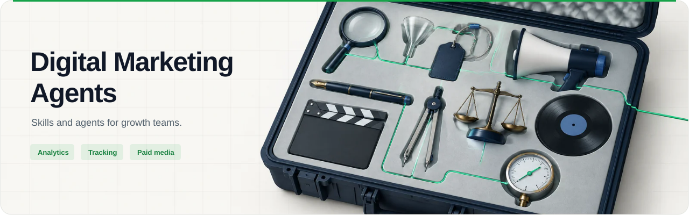

<p align="center">
  
</p>

# Digital Marketing Agents

Skills and agents for analytics, tracking, paid media and SEO work in Claude Code.

[](LICENSE)

[What you can do](#what-you-can-do) | [Installation](#installation) | [Use cases](#use-cases) | [Overlays](#overlays) | [License](#license)

A Claude Code plugin marketplace with two plugins. `digital-marketing-agents` adds nine specialist skills for analytics, measurement, tracking, paid media, SEO, data, architecture, client communication and public writing, plus a reviewer agent, a legal agent and a commit gate that waits for the reviewer's verdict. `seo-articles` writes and revises SEO articles around one reader decision. The skills carry the method only; client names, account IDs and data traps go in private overlay files that the skills read when present.

## What you can do

| Plugin | What it covers |
| --- | --- |
| `digital-marketing-agents` | Specialist skills and agents for agency-style growth and measurement work, and a PreToolUse hook that refuses `git commit` until the reviewer has stamped the current diff |
| `seo-articles` | Articles, explainers, glossary entries and calculator copy built around one reader decision, with reproducible worked examples, schema that matches the page and a finance checklist |

The `digital-marketing-agents` plugin contains:

| Skill or agent | Use it for |
| --- | --- |
| `analyst` | A number with evidence: funnels, cohorts, CPA, attribution gaps, with the query to rerun it |
| `measurement-architect` | Tracking plans, identity model, server-side conversion flows, GTM and warehouse layout |
| `tracking-engineer` | Missing, doubled or mismatched events, CAPI and offline conversions, GTM container review |
| `paid-media` | Pacing and anomaly checks, launch structure, read-only account audits, creative briefs |
| `seo` | Indexing, Core Web Vitals, structured data, keyword clusters and content gaps from Search Console |
| `data-engineer` | SQL, schema and migrations, BigQuery scan cost, reproducible exports |
| `software-architect` | A plan before code: files to touch, migrations, contracts, risks, verification |
| `account-manager` | Client reports, status notes, decks, specs and open-question lists |
| `content-writer` | Posts, site pages, case studies and landing copy without AI markers |
| `reviewer` (agent) | A ship or fix-first verdict on a diff, deliverable, ad copy or analysis |
| `legal` (agent) | A ranked risk register for finance ads, loan and insurance pages, app listings and privacy changes |

## Installation

In Claude Code:

```text
/plugin marketplace add arcbaslow/digital-marketing-agents
/plugin install digital-marketing-agents@digital-marketing-agents
/plugin install seo-articles@digital-marketing-agents
```

From a shell, the same commands are `claude plugin marketplace add arcbaslow/digital-marketing-agents` and `claude plugin install <plugin>@digital-marketing-agents`.

The commit gate and `install.js` need Node.js. The personas expect MCP tools for GA4, Google Ads, Search Console, GTM, Meta, Amplitude, Mixpanel and BigQuery; connect the ones you use.

Then set up overlays and the routing block:

```bash
git clone https://github.com/arcbaslow/digital-marketing-agents.git
node digital-marketing-agents/install.js
```

`install.js` creates `~/.claude/overlays` and appends a `## Personas` block to `~/.claude/CLAUDE.md` if none exists. The block tells Claude to invoke a matching persona before its first tool call and to run the reviewer before commits.

## Use cases

**Explain a drop.** You ask: "Leads from Meta fell 30% last week. Is that real?" `analyst` reads the source map in your overlay, queries Meta and the product analytics tool for the same window and time zone, and names known losses (iOS storage, platform dedup) before reading the gap. You get the answer with the number in the first line, one table per cut, the query to rerun it and what could change the conclusion.

**Find doubled conversions.** You ask: "Meta reports twice the purchases our backend has." `tracking-engineer` fires the event on the live page, captures the Pixel and CAPI payloads and compares the `event_id` both sides send. You get the root cause with evidence and the smallest fix; nothing is published until you say yes.

**Plan tracking for a new flow.** You ask: "How do we track the new checkout flow across web and app?" `measurement-architect` starts from the decision the data must support, maps which id joins which surface, and keeps the event set to the minimum. You get a design table with owner, trigger, destination, dedup key and consent gate per flow, plus the open questions.

**Launch a campaign.** You ask: "Set up a Meta lead campaign for the new landing page." `paid-media` drafts objective, budget level, audience, explicit location types, UTM template and naming, and writes the stop rule before launch. You get the structure and a numbered list of proposed writes; nothing changes in the ad account until you confirm each one.

**Review before a commit.** You ask Claude to commit. The hook refuses the commit until `reviewer` has run on the diff. The reviewer checks scope, correctness, dead exports, comment density, secrets and PII, then returns `ship` or `fix first` with ranked findings and stamps the result. The commit goes through only on a ship stamp that matches the current working tree.

**Write a finance explainer.** You ask: "Rewrite our credit card fees explainer." `seo-articles` reads the project's style guide and manifest, rebuilds the page around one reader decision, recomputes the worked example in a script and keeps the JSON-LD identical to the visible page. `legal` then returns a risk register for the rate and fee claims, citing the current rule text.

## Overlays

Each persona skill, both agents and `seo-articles` start by reading `~/.claude/overlays/<name>.md` when it exists, for example `~/.claude/overlays/analyst.md`. Put there what only your setup knows: client names, account and project IDs, where your notes live and their section names, client rules and forbidden phrasings, time zones and known data traps. The public skill stays generic and the overlay adds the specifics, so the plugin can be updated without touching private files. Keep overlays outside this repository, for example in a private notes repo linked to `~/.claude/overlays`.

```markdown
# analyst overlay

## Source map
| Source | Clients |
|---|---|
| Amplitude | Example Retail (project 123456) |

## Rules
- Time zone: Europe/Berlin for all clients.
- Example Retail reports orders from its order system, not GA4 purchases.
```

## License

[MIT](LICENSE). This is an independent project; it is not affiliated with Anthropic or the platform vendors named here.

Maintained by [Good Labs](https://goodlabs.kz) - measurement implementation, tracking plans and analytics audits.
